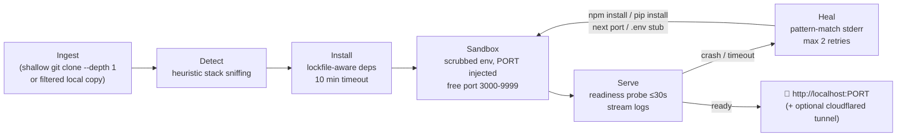

# VIBE Architecture (v0.1.0)

VIBE is a zero-touch execution engine: give it any repo, get a running app.
One command, no config files, no Dockerfile required.

## Pipeline

## Modules (`src/`)

| File | Responsibility |
|---|---|
| `cli.ts` | commander entry: default `run` command, `doctor`, `badge`, `clean` |
| `run.ts` | Orchestrates ingest → detect → install → launch → heal → serve; `--docker` path |
| `detect.ts` | Honest heuristics: Node (lockfile → pm, `start` script → entry files → `dev`), Python (venv + flask/fastapi/django/streamlit/plain sniffing), Go (`go run .`), Rust (`cargo run`), static (`http.server`), else `unknown` with an actionable error |
| `heal.ts` | Pure pattern matchers: `Cannot find module 'x'` → `npm install x`; `No module named 'x'` → `pip install x`; `EADDRINUSE` → next free port; missing `ALL_CAPS` env var → `.env` stub + loud warning. Every action is printed before it runs. |
| `sandbox.ts` | Process sandbox: env allowlist + `PORT`, `{PORT}` argv templating, HTTP readiness probe (any response = alive), log ring buffer, detached process-tree kill on exit, cloudflared tunnel, docker build/run |
| `ports.ts` | Free-port scanner (3000–9999) |
| `doctor.ts` | Tool availability table with install hints |
| `util.ts` | `execFile` wrapper, `which`, `copyDirFiltered`, slug helpers |

## v0.1.0 scope & limits (honest)

- **No real microVM / WASM sandbox yet.** The sandbox is a child process with a
  scrubbed environment (allowlisted vars only), its own working directory, and
  a hard kill on exit. Container-first execution (`--docker`) exists for the
  Dockerfile path. A microVM backend is on the roadmap, not in this release.
- **Heuristics, not magic.** Detection covers the common stacks above. Exotic
  monorepos, multi-service compose setups, and GPU/PyTorch workloads are out
  of scope for v0.1.0 — `vibe` will tell you plainly when it can't run something.
- **Self-heal is bounded.** Max 2 repair attempts, and every repair is printed.
  It fixes missing deps, port clashes, and missing env vars — not logic bugs.
- **No telemetry, no accounts, no network calls** except `git clone`, package
  installs, and the optional `--tunnel`. Your code never leaves your machine
  unless you ask for a tunnel.

## Roadmap

- Container-first default (build a throwaway image per run, no host pollution)
- microVM backend (Firecracker) for untrusted code
- `vibe deploy` — one-click export to Fly/Render/AWS with secrets wiring
- Lockfile for detected plans (`vibe plan > vibe.lock`, reproducible reruns)
- Windows-native support (venv/Scripts paths, job objects for kill-tree)
